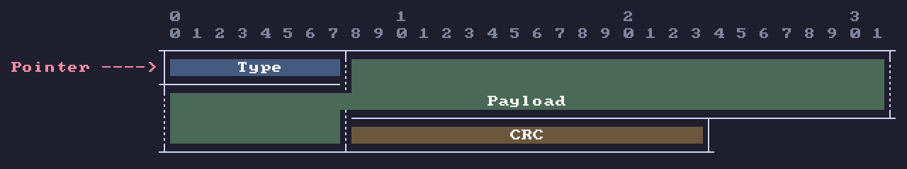
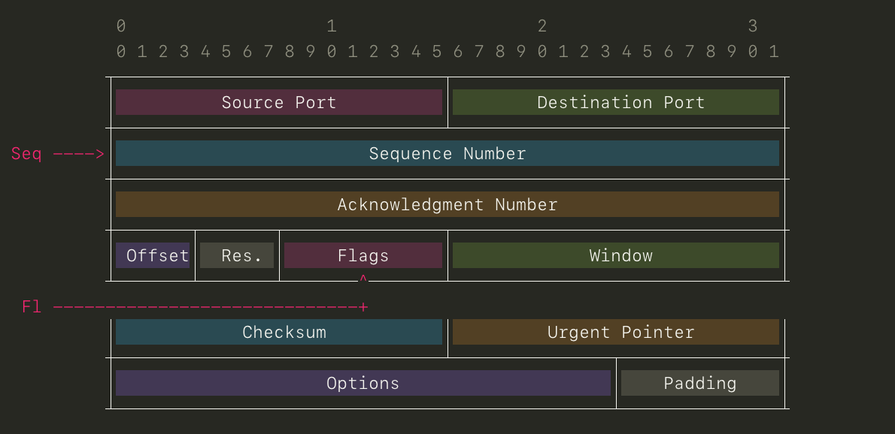
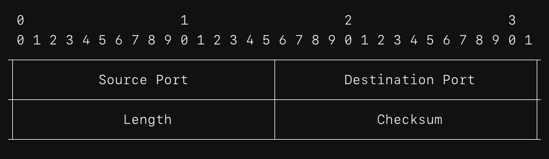

# protocol (C++ edition)

```
                  ____            _                  _
                 |  _ \ _ __ ___ | |_ ___   ___ ___ | |
                 | |_) | '__/ _ \| __/ _ \ / __/ _ \| |
                 |  __/| | | (_) | || (_) | (_| (_) | |
                 |_|   |_|  \___/ \__\___/ \___\___/|_|
```

A command-line tool that draws **network protocol header diagrams**. This is a
C++ rewrite of the original Python tool
[protocol](https://github.com/luismartingarcia/protocol) by Luis MartinGarcia,
extended with:

* **PNG image export** — crisp pixel-art diagrams, no external dependencies
* **SVG image export** — clean vector diagrams for documents and slides
* **12 color themes** — for images *and* terminal output (ANSI truecolor)
* **Variable-length fields** — dashed edges (`~`) mark fields whose length is
  not fixed, RFC 8300 style
* **Pointer arrows** — annotate rows or fields with labeled arrows
  (`--pointer "Pointer@3"`)
* **Escape sequences** — field names may contain `,`, `:`, `?` and more via
  backslash escapes (`"Seq\\, Nr:8"`)
* Multiple protocols can be stacked into a single image

The ASCII output is byte-for-byte compatible with the original Python tool
(verified by the regression tests in `tests/`).

[中文文档请见下方](#中文文档)


## Table of contents

- [protocol (C++ edition)](#protocol-c-edition)
  - [Table of contents](#table-of-contents)
  - [Features](#features)
  - [Building](#building)
    - [Prerequisites](#prerequisites)
    - [Quick build](#quick-build)
    - [macOS](#macos)
    - [Debian / Ubuntu](#debian--ubuntu)
    - [Fedora / RHEL / CentOS](#fedora--rhel--centos)
    - [Arch Linux](#arch-linux)
    - [Windows](#windows)
    - [Build types](#build-types)
    - [Installing](#installing)
    - [Building without CMake](#building-without-cmake)
    - [Verifying the build](#verifying-the-build)
  - [Usage](#usage)
    - [Command-line syntax](#command-line-syntax)
    - [Option reference](#option-reference)
    - [Displaying built-in protocols](#displaying-built-in-protocols)
    - [Built-in protocols](#built-in-protocols)
    - [Custom protocol specifications](#custom-protocol-specifications)
    - [Escape sequences](#escape-sequences)
    - [Variable-length fields](#variable-length-fields)
    - [Pointer arrows](#pointer-arrows)
    - [Reading specs from a file](#reading-specs-from-a-file)
    - [Output formats](#output-formats)
    - [Color themes](#color-themes)
    - [Exit status](#exit-status)
  - [Examples](#examples)
  - [Project layout](#project-layout)
  - [Testing](#testing)
  - [Third-party components](#third-party-components)
  - [License](#license)
- [中文文档](#中文文档)
  - [目录](#目录)
  - [功能特性](#功能特性)
  - [编译安装](#编译安装)
    - [环境要求](#环境要求)
    - [快速构建（Unix 通用）](#快速构建unix-通用)
    - [macOS](#macos-1)
    - [Debian / Ubuntu](#debian--ubuntu-1)
    - [Fedora / RHEL / CentOS](#fedora--rhel--centos-1)
    - [Arch Linux](#arch-linux-1)
    - [Windows](#windows-1)
    - [构建类型](#构建类型)
    - [安装到系统](#安装到系统)
    - [不用 CMake 直接编译](#不用-cmake-直接编译)
    - [验证构建](#验证构建)
  - [使用方法](#使用方法)
    - [命令语法](#命令语法)
    - [选项一览](#选项一览)
    - [显示内置协议](#显示内置协议)
    - [内置协议列表](#内置协议列表)
    - [自定义协议规格](#自定义协议规格)
    - [转义序列](#转义序列)
    - [变长字段](#变长字段)
    - [指针箭头](#指针箭头)
    - [从文件读取规格](#从文件读取规格)
    - [输出格式](#输出格式)
    - [颜色主题](#颜色主题)
    - [退出状态码](#退出状态码)
  - [命令示例](#命令示例)
  - [项目结构](#项目结构)
  - [测试](#测试)
  - [许可证](#许可证)

## Features

* Print RFC-like ASCII diagrams of the most common protocol headers directly
  in your terminal — 40 built-in protocols (Ethernet, 802.1q, TCP, UDP, IPv4,
  IPv6, ICMP, ICMPv6, DHCP, Modbus-TCP, Profinet-RT, DNP3, TSAP, COTP, S7, ...).
* Generate diagrams for your **own protocols** with a compact one-line spec
  syntax: `"Type:8,Code:8,Checksum:16,Payload:64"`.
* Fields of any bit length; fields that do not fit on one line are wrapped
  automatically with merged border lines, just like in RFC diagrams.
* Fields of **variable/undefined length** render with dashed `~` edges;
  **pointer arrows** can annotate any row or field.
* Configurable bits per line, optional bit-number rows, custom border
  characters.
* Field names may contain special characters via **backslash escapes**
  (`\,`, `\:`, `\?`, `\\`, ...).
* Three output formats: **text** (plain or ANSI-colored), **SVG**, **PNG**.
* **Zero external dependencies**: the PNG encoder (stb_image_write), the
  TrueType rasterizer (stb_truetype) and an 8x8 fallback bitmap font are all
  embedded in the repository (public domain). Only a C++17 compiler and
  CMake are needed.

## Building

### Prerequisites

| Requirement | Notes |
|---|---|
| C++17 compiler | GCC ≥ 7, Clang ≥ 5, Apple Clang, MSVC ≥ 2017 |
| CMake ≥ 3.16 | Only for the standard build; you can also [compile directly](#building-without-cmake) |

There are **no library dependencies** (no libpng, no zlib, nothing else) —
everything needed ships in this repository.

### Quick build

On any Unix-like system:

```sh
cmake -B build -DCMAKE_BUILD_TYPE=Release
cmake --build build
```

The binary is created at `build/protocol`. Run it:

```sh
./build/protocol tcp
```

### macOS

```sh
# Install the toolchain if needed:
xcode-select --install          # Apple Clang
brew install cmake              # CMake (via Homebrew)

cmake -B build -DCMAKE_BUILD_TYPE=Release
cmake --build build
```

### Debian / Ubuntu

```sh
sudo apt update
sudo apt install build-essential cmake

cmake -B build -DCMAKE_BUILD_TYPE=Release
cmake --build build
```

### Fedora / RHEL / CentOS

```sh
sudo dnf install gcc-c++ cmake

cmake -B build -DCMAKE_BUILD_TYPE=Release
cmake --build build
```

### Arch Linux

```sh
sudo pacman -S base-devel cmake

cmake -B build -DCMAKE_BUILD_TYPE=Release
cmake --build build
```

### Windows

**With MSVC (Visual Studio 2017 or later, CMake included):**

```bat
cmake -B build
cmake --build build --config Release
```

The executable is `build\Release\protocol.exe`.

**With MinGW-w64:**

```bat
cmake -B build -G "MinGW Makefiles" -DCMAKE_BUILD_TYPE=Release
cmake --build build
```

**With clang-cl / Ninja** also works out of the box. Note that colored
terminal output (`--color`) requires a terminal with ANSI support, e.g.
Windows Terminal.

### Build types

* `Release` (default): optimized (`-O2`-level) — recommended.
* `Debug`: no optimizations, debug symbols, useful for development.

```sh
cmake -B build -DCMAKE_BUILD_TYPE=Debug
cmake --build build
```

### Installing

To install system-wide (default prefix `/usr/local`):

```sh
sudo cmake --install build
```

To install into a custom prefix:

```sh
cmake -B build -DCMAKE_INSTALL_PREFIX="$HOME/.local"
cmake --build build
cmake --install build        # binary goes to $HOME/.local/bin
```

### Building without CMake

The project is a small set of translation units, so a single compiler
invocation is enough:

```sh
# GCC or Clang on Linux / macOS
c++ -std=c++17 -O2 -fno-strict-aliasing -Isrc -Ithird_party \
    src/main.cpp src/protocol.cpp src/specs.cpp src/theme.cpp \
    src/render_text.cpp src/render_svg.cpp src/render_png.cpp \
    -o protocol
```

(`-fno-strict-aliasing` is a safety recommendation from the stb_image_write
documentation; the CMake build applies it to that file only.)

### Verifying the build

Run the regression test suite (golden/integration tests comparing against the
original Python implementation, plus the unit tests):

```sh
./build/protocol_unit_tests   # unit tests for the core library
./tests/run_tests.sh          # golden/integration tests
# or everything through CTest:
ctest --test-dir build --output-on-failure
```

Expected result: `passed: 98, failed: 0` and a zero exit status from
`protocol_unit_tests`.

## Usage

### Command-line syntax

```
protocol {<protocol> or <spec>} [OPTIONS]
```

* `<protocol>` — the name of a built-in protocol (see `protocol --list`).
* `<spec>` — a field-by-field specification of a custom protocol, e.g.
  `"Type:8,Code:8,Checksum:16"`. Any argument containing `:` is treated as a
  spec.

You may pass several protocols/specs at once; they are rendered one after
another (stacked into a single canvas for image formats).

### Option reference

| Option | Description |
|---|---|
| **Input** | |
| `-f, --file <file>` | Read protocol specs from a text file (one per line) |
| **Diagram layout** | |
| `-b, --bits <n>` | Number of bits per line (default: 32, per-spec `?bits=` overrides, this option overrides everything) |
| `-n, --no-numbers` | Do not print the bit-number rows on top of the header |
| `--evenchar <c>` | Character for the even positions of horizontal borders (default: `-`) |
| `--oddchar <c>` | Character for the odd positions of horizontal borders (default: `+`) |
| `--startchar <c>` | Character that starts horizontal borders (default: `+`) |
| `--endchar <c>` | Character that ends horizontal borders (default: `+`) |
| `--sepchar <c>` | Character that separates protocol fields (default: `\|`) |
| **Output** | |
| `-o, --output <file>` | Write output to a file; the format is taken from the extension (`.txt`, `.svg`, `.png`) unless `--format` is given |
| `--format <fmt>` | Output format: `text`, `svg` or `png` (default: `text`) |
| **Color** | |
| `-t, --theme <name>` | Color theme (default: `none` for text output, `light` for svg/png); see `protocol --list-themes` |
| `--fg <color>` | Global foreground color override (borders, numbers, labels, pointers) — color name or `#RGB`/`#RRGGBB` |
| `--bg <color>` | Canvas background color override (PNG/SVG) — same color syntax |
| `--list-colors` | List the available color names |
| `--color <mode>` | ANSI colors for terminal text output: `auto` (only when stdout is a TTY), `always`, `never` (default: `auto`) |
| `--pointer <l@t>` | Add a pointer arrow with label `l` targeting row number or field name `t` (repeatable); see [Pointer arrows](#pointer-arrows) |
| **PNG / SVG** | |
| `--scale <n>` | PNG pixel scale, integer 1–8 (default: 2) |
| `--transparent` | Transparent canvas background for PNG/SVG |
| `--no-fill` | Transparent field backgrounds (no field fill colors; spec-level: `fill=n`) |
| `--ascii` | Render SVG/PNG exactly like the terminal ASCII output (characters as glyphs, no line primitives) |
| `--font <file.ttf>` | PNG: TrueType font file (default: best system monospace font, embedded 8x8 font as fallback) |
| `--font-family <name>` | SVG: preferred font family, prepended to the modern default stack |
| **Information** | |
| `--list` | List the built-in protocols |
| `--list-themes` | List the available color themes |
| `-h, --help` | Display help |
| `-V, --version` | Display version |

### Displaying built-in protocols

```sh
protocol tcp
protocol tcp udp          # several at once
protocol dot1q ethernet
```

Protocol names don't need to be fully specified as long as there is no
ambiguity — `protocol et` is equivalent to `protocol ethernet`. If the
prefix is ambiguous, the candidates are listed:

```
$ protocol icmpv6-r
Ambiguous protocol specifier 'icmpv6-r'. Did you mean any of these?
  icmpv6-radv
  icmpv6-redirect
  icmpv6-rsol
```

### Built-in protocols

| Name | Description |
|---|---|
| `ethernet` | Ethernet |
| `8021q`, `dot1q` | IEEE 802.1q VLAN tag |
| `tcp` | Transmission Control Protocol |
| `udp` | User Datagram Protocol |
| `ip` | Internet Protocol, version 4 |
| `ipv6` | Internet Protocol, version 6 |
| `icmp` | Internet Control Message Protocol (ICMP) |
| `icmp-destination` | ICMP Destination Unreachable |
| `icmp-time` | ICMP Time Exceeded |
| `icmp-parameter` | ICMP Parameter Problem |
| `icmp-source` | ICMP Source Quench |
| `icmp-redirect` | ICMP Redirect |
| `icmp-echo` | ICMP Echo Request/Reply |
| `icmp-timestamp` | ICMP Timestamp Request/Reply |
| `icmp-information` | ICMP Information Request/Reply |
| `icmpv6` | ICMP for IPv6 (ICMPv6) |
| `icmpv6-destination` | ICMPv6 Destination Unreachable |
| `icmpv6-big` | ICMPv6 Packet Too Big |
| `icmpv6-time` | ICMPv6 Time Exceeded |
| `icmpv6-parameter` | ICMPv6 Parameter Problem |
| `icmpv6-echo` | ICMPv6 Echo Request/Reply |
| `icmpv6-rsol` | ICMPv6 Router Solicitation |
| `icmpv6-radv` | ICMPv6 Router Advertisement |
| `icmpv6-nsol` | ICMPv6 Neighbor Solicitation |
| `icmpv6-nadv` | ICMPv6 Neighbor Advertisement |
| `icmpv6-redirect` | ICMPv6 Redirect |
| `dhcp` | Dynamic Host Configuration Protocol |
| `modbus_tcp` | Modbus-TCP |
| `profinet_rt` | Profinet-RT |
| `dnp3` | DNP3 |
| `tsap` | TSAP |
| `cotp_cr` | COTP Connection Request |
| `cotp_dt` | COTP Data |
| `cotp_dr` | COTP Disconnect Request |
| `s7_header` | S7 communication header |
| `s7_item` | S7 communication item |
| `s7_data` | S7 communication data |
| `example` | Demo spec using custom border characters |
| `test` | Stress-test spec (fields of 1..127 bits) |

### Custom protocol specifications

A spec has the form `"<FIELD_LIST>[?OPTIONS]"`:

* **FIELD_LIST** — a comma-separated list of `name:length` tuples. `name` is
  the field label (see [Escape sequences](#escape-sequences) for using `,`,
  `:` or `?` inside names). `length` is an integer > 0: the field width in
  bits; suffix it with `~` or `*` to mark a
  [variable-length field](#variable-length-fields) (`Payload:64~`). Do **not**
  put whitespace after the commas.
* **OPTIONS** — an optional comma-separated list of `key=value` modifiers,
  introduced by a `?`.

Examples of field lists:

```
Type:8,Code:8,Checksum:16,Message Body:64
Source Port:16,Destination Port:16,Length:16,Checksum:16
Payload:64~                          # variable-length field (dashed edges)
Seq\, Nr:8,What\:ify\?:8             # escaped ',' and ':'/'?' in names
```

Field lengths don't need to align to the line width; long fields wrap to the
next line automatically:

```
$ protocol "Source:16,TTL:8,Reserved:40"
 0                   1                   2                   3
 0 1 2 3 4 5 6 7 8 9 0 1 2 3 4 5 6 7 8 9 0 1 2 3 4 5 6 7 8 9 0 1
+-+-+-+-+-+-+-+-+-+-+-+-+-+-+-+-+-+-+-+-+-+-+-+-+-+-+-+-+-+-+-+-+
|             Source            |      TTL      |               |
+-+-+-+-+-+-+-+-+-+-+-+-+-+-+-+-+-+-+-+-+-+-+-+-+               +
|                            Reserved                           |
+-+-+-+-+-+-+-+-+-+-+-+-+-+-+-+-+-+-+-+-+-+-+-+-+-+-+-+-+-+-+-+-+
```

Available per-spec options:

| Option | Values | Description |
|---|---|---|
| `bits=<n>` | integer > 0 | Bits per line (default: 32, same as IETF) |
| `numbers=<y/n>` | `1 y yes true` / `0 n no false` | Print or hide the bit-number rows |
| `evenchar=<c>` | single char | Character for even positions of horizontal borders (default `-`) |
| `oddchar=<c>` | single char | Character for odd positions of horizontal borders (default `+`) |
| `startchar=<c>` | single char | First character of horizontal borders (default `+`) |
| `endchar=<c>` | single char | Last character of horizontal borders (default `+`) |
| `sepchar=<c>` | single char | Field separator character (default `\|`) |
| `pointer=<l@t>` | label + target | Add a [pointer arrow](#pointer-arrows): `pointer=Pointer@3` or `pointer=Pointer@Checksum`; repeatable |

### Escape sequences

Field names (and pointer labels) may contain characters that are otherwise
special in a spec. Prefix them with a backslash to use them literally:

| Escape | Result | Where it matters |
|---|---|---|
| `\,` | a literal `,` | field lists and option lists would otherwise split there |
| `\:` | a literal `:` | would otherwise separate name from length |
| `\?` | a literal `?` | would otherwise start the options part |
| `\=` | a literal `=` | would otherwise separate option key from value |
| `\~`, `\*` | literal `~`, `*` | a trailing one would otherwise mark a variable-length field |
| `\\` | a literal `\` | the escape character itself |

Any other character after `\` is also taken literally. A lone backslash at
the very end is kept as-is.

```
$ protocol "Seq\, Nr:8,What\:ify\?:8,Code:16"
 0                   1                   2                   3
 0 1 2 3 4 5 6 7 8 9 0 1 2 3 4 5 6 7 8 9 0 1 2 3 4 5 6 7 8 9 0 1
+-+-+-+-+-+-+-+-+-+-+-+-+-+-+-+-+-+-+-+-+-+-+-+-+-+-+-+-+-+-+-+-+
|    Seq, Nr    |   What:ify?   |              Code             |
+-+-+-+-+-+-+-+-+-+-+-+-+-+-+-+-+-+-+-+-+-+-+-+-+-+-+-+-+-+-+-+-+
```

### Variable-length fields

Suffix a field's length with `~` (or `*`) to declare it **variable-length**
(undefined length): the number is only the nominal display length, and the
field's vertical edges are drawn dashed (`~` in ASCII; widely spaced dashes
in SVG/PNG), following the RFC 8300 convention. The rest of the layout —
wrapping, merged borders, bit numbers — works as usual.

```
$ protocol "Type:8,Payload:32~,CRC:16"
 0                   1                   2                   3
 0 1 2 3 4 5 6 7 8 9 0 1 2 3 4 5 6 7 8 9 0 1 2 3 4 5 6 7 8 9 0 1
+-+-+-+-+-+-+-+-+-+-+-+-+-+-+-+-+-+-+-+-+-+-+-+-+-+-+-+-+-+-+-+-+
|      Type     ~                    Payload                    ~
+-+-+-+-+-+-+-+-+-+-+-+-+-+-+-+-+-+-+-+-+-+-+-+-+-+-+-+-+-+-+-+-+
~               ~              CRC              |
+-+-+-+-+-+-+-+-+-+-+-+-+-+-+-+-+-+-+-+-+-+-+-+-+
```



### Pointer arrows

`--pointer "label@target"` draws a labeled arrow at the left of a diagram
row, e.g. `--pointer "Pointer@3"`. It can be repeated, and is also available
per spec as the `pointer=` option (repeatable as well):

```
protocol tcp --pointer "Pointer@3"
protocol "Type:8,Data:16,Code:8?pointer=Ptr@Data"
```

The **target** may be:

* a **content row number** (1-based; content rows are the diagram lines that
  carry fields — bit-number rows and pure border lines are not counted) — a
  horizontal arrow is drawn from the left margin to the row's start;
* a **field name** (case-insensitive) — an **elbow arrow** is routed into the
  row: the shaft runs from the left margin to beneath the field's center,
  turns up with a `+` corner, and a `^` arrowhead lands in the border right
  below the field's box. For fields that wrap across lines, the arrow aims at
  the row where the field's label is printed.

Routing and layout are **automatic and non-destructive**:

* each field pointer gets its own "lane" row inserted below the target row's
  bottom border, so the diagram itself is never overwritten and stays
  perfectly aligned (also in `--ascii` and multi-protocol stacking);
* an out-of-range row number is clamped to the nearest valid row and a
  warning is printed to stderr (the command still succeeds);
* an unknown field name is a clean error listing the available field names;
* several pointers on the same target have their labels merged
  (`"First, Also ---->"`);
* labels are right-aligned so arrows line up, and when several protocols are
  stacked into one image their diagrams are aligned automatically;
* labels support the same [escape sequences](#escape-sequences)
  (`--pointer "Start\\, middle@1"`).

```
$ protocol udp --pointer "Source ports@1" --pointer "Ptr@Checksum"
                   0                   1                   2                   3
                   0 1 2 3 4 5 6 7 8 9 0 1 2 3 4 5 6 7 8 9 0 1 2 3 4 5 6 7 8 9 0 1
                  +-+-+-+-+-+-+-+-+-+-+-+-+-+-+-+-+-+-+-+-+-+-+-+-+-+-+-+-+-+-+-+-+
Source ports ---->|          Source Port          |        Destination Port       |
                  +-+-+-+-+-+-+-+-+-+-+-+-+-+-+-+-+-+-+-+-+-+-+-+-+-+-+-+-+-+-+-+-+
                  |             Length            |            Checksum           |
                  +-+-+-+-+-+-+-+-+-+-+-+-+-+-+-+-+-+-+-+-+-+-+-+-^-+-+-+-+-+-+-+-+
         Ptr -----------------------------------------------------+
```

Pointer labels and arrows are colored with the theme's accent color
(text via ANSI, SVG/PNG via the theme palette).



The following diagram shows where each character modifier applies:

```
   Bit counts                                                     sepchar(|)
     ^   ^                                                              |
     |   |                                                              |
     0   |               1                   2                   3      |
     0 1 2 3 4 5 6 7 8 9 0 1 2 3 4 5 6 7 8 9 0 1 2 3 4 5 6 7 8 9 0 1    |
    +-+-+-+-+-+-+-+-+-+-+-+-+-+-+-+-+-+-+-+-+-+-+-+-+-+-+-+-+-+-+-+-+   |
    |             Source            |      TTL      |    Reserved   | <-+
    +-+-+-+-+-+-+-+-+-+-+-+-+-+-+-+-+-+-+-+-+-+-+-+-+-+-+-+-+-+-+-+-+
    ^              ^ ^ ^              ^ ^ ^                         ^
    |              | | |              | | |                         |
 startchar(+)     evenchar(-)        oddchar(+)                  endchar(+)

    |<------------------------------------------------------------->|
                               bits(32)
```

### Reading specs from a file

`-f/--file` reads specs from a text file: one spec per line, empty lines are
ignored and lines starting with `#` are comments.

```
# my_protocols.txt — custom protocol collection
Type:8,Code:8,Checksum:16,Message Body:64
Length:16,Checksum:16?bits=16,numbers=n
```

```sh
protocol -f my_protocols.txt                # print both as ASCII
protocol -f my_protocols.txt -o all.svg     # stack both into one SVG
```

### Output formats

**Text (default).** The classic RFC-like ASCII diagram. With no `-o`, it goes
to standard output; with `-o file.txt` it is written to the file. ANSI colors
are applied when a non-`none` theme is selected *and* color is enabled
(`--color auto` enables colors only if stdout is a terminal). Files never get
escape sequences.

**SVG.** Vector output, ideal for documentation and slides. Field backgrounds
are drawn as rectangles, borders as continuous lines, labels as real text.
Text uses a modern monospace font stack (`JetBrains Mono`, `Fira Code`,
`Cascadia Code`, `ui-monospace`, `SF Mono`, `Menlo`, `Consolas`,
`DejaVu Sans Mono`, ...) resolved by the viewer; prepend your own with
`--font-family "My Mono"`. Write to a file with `-o file.svg` or pipe it from
stdout (`--format svg`). `--transparent` omits the background rectangle;
`--no-fill` omits the field fills.

**PNG.** Bitmap output rendered with a **modern TrueType monospace font**:
the best available system font is auto-detected (JetBrains Mono, Fira Code,
Cascadia, SF Mono, Menlo, Consolas, DejaVu Sans Mono, ...) and rasterized
with anti-aliasing; `--font path/to/font.ttf` picks a specific font file
(TTF/OTF/TTC). If no system font is found, an embedded 8x8 bitmap font is
used as a fallback (retro pixel look). `--scale <n>` (1–8, default 2)
multiplies the pixel size. `--transparent` gives a transparent canvas
(glyphs stay opaque); `--no-fill` additionally leaves field backgrounds
unfilled. Encoding is done by the bundled stb_image_write — no libpng needed.

**ASCII rendering mode (`--ascii`).** By default, SVG/PNG output draws
borders as continuous line primitives ("pretty" mode). With `--ascii`, every
character of the diagram (`+`, `-`, `|`, `~`, labels, numbers) is drawn as a
glyph, exactly like the terminal text output — a "terminal screenshot" style
image, in a smooth modern font (PNG) or the SVG font stack.

Format selection order: `--format` wins over the `-o` file extension; without
either, the format is `text`.

### Color themes

```
$ protocol --list-themes
```

| Theme | Look |
|---|---|
| `none` | Plain black on white (classic RFC look, no field colors) |
| `rfc` | White background, light gray alternation |
| `light` | Light background with pastel field colors (default for images) |
| `dark` | Dark background with vibrant accents |
| `solarized` | Solarized light palette |
| `solarized-dark` | Solarized dark palette |
| `monokai` | Monokai editor palette |
| `ocean` | Deep ocean blues |
| `forest` | Forest greens |
| `sunset` | Warm sunset tones on a light background |
| `candy` | Bright candy colors |
| `grayscale` | Grayscale alternation, print friendly |

Fields are colored cyclically from the theme palette so neighbouring fields
always differ; a field spanning several lines keeps a single color. Themes
apply to all three output formats (text via ANSI truecolor escapes).

| `light` | `dark` | `ocean` |
|---|---|---|
|  |  |  |

### Custom colors

On top of themes, two options override individual colors globally:

* `--fg <color>` — the foreground "ink": border lines, bit numbers, field
  labels and pointer arrows (all output formats, including ANSI text).
* `--bg <color>` — the canvas background (PNG/SVG).

The color is either a well-known name (case-insensitive; ~55 standard CSS
color names such as `white`, `black`, `tomato`, `slategray`, `gold`,
`dodgerblue` — run `protocol --list-colors` for the full list) or a
hexadecimal RGB value `#RGB` / `#RRGGBB`. Quote hex values in your shell,
since `#` starts a comment otherwise: `--fg '#ff8800'`.

**Recipe: diagrams for dark web pages.** White line art on a transparent
canvas stays readable on dark backgrounds:

```sh
protocol udp -o udp_white.png --transparent --fg white --no-fill
```

(`--no-fill` removes the field fill colors; drop it if you want colored
fields with white text.) The same recipe rendered on a black background:



### Exit status

* `0` — success
* `1` — any error (invalid spec, unknown protocol/theme/option, unreadable
  file, unwritable output, ...). Error messages go to standard error.

## Examples

```sh
# 1. Classic ASCII diagram of the TCP header
protocol tcp

# 2. Several protocols at once
protocol ip tcp udp

# 3. Custom protocol from a one-line spec
protocol "Type:8,Code:8,Checksum:16,Payload:64"

# 4. Custom bits-per-line and hidden bit numbers
protocol "Length:16,Checksum:16?bits=16,numbers=n"
protocol tcp -b 16 -n

# 5. Custom border characters
protocol "Field4:4,Field4:4,Field8:8,Field16:16?bits=16,startchar=*,endchar=*"
protocol tcp --startchar '*' --endchar '*' --evenchar '=' --oddchar '-' --sepchar '!'

# 6. Colored terminal output (ANSI truecolor)
protocol ipv6 --theme ocean --color always

# 7. SVG image (default "light" theme)
protocol tcp -o tcp.svg

# 8. PNG image with theme and 3x scale
protocol tcp -o tcp.png --theme dark --scale 3

# 9. Several protocols stacked into one image
protocol ip tcp udp -o stack.svg --theme solarized
protocol ip tcp udp -o stack.png --theme dark

# 10. Transparent background PNG (e.g. for slides)
protocol icmp -o icmp.png --theme sunset --transparent

# 11. Write SVG / PNG to stdout (e.g. for pipelines)
protocol tcp --format svg > tcp.svg
protocol udp --format png > udp.png

# 12. Render specs from a file
protocol -f my_protocols.txt -o all.svg --theme forest

# 13. Short unique prefixes work
protocol et              # == protocol ethernet
protocol s7_h            # == protocol s7_header

# 14. Variable-length field (dashed '~' edges)
protocol "Type:8,Payload:64~,CRC:16"
protocol "Type:8,Payload:64~,CRC:16" -o varlen.png --theme dark

# 15. Pointer arrows
protocol tcp --pointer "Pointer@3"
protocol udp --pointer "Ptr@Checksum" -o udp.svg --theme ocean

# 16. Escaped special characters in field names
protocol "Seq\\, Nr:8,What\\:ify\\?:8,Code:16"

# 17. ASCII-look images (identical to the terminal output, glyph by glyph)
protocol tcp -o tcp_ascii.png --ascii --theme dark
protocol tcp -o tcp_ascii.svg --ascii

# 18. Transparent field backgrounds (borders and labels only)
protocol tcp -o tcp_nofill.png --no-fill
protocol udp -o udp_float.png --no-fill --transparent --theme ocean

# 19. Custom fonts (PNG: TTF file; SVG: font family name)
protocol tcp -o tcp.png --font /System/Library/Fonts/Menlo.ttc
protocol tcp -o tcp.svg --font-family "JetBrains Mono"

# 20. Custom colors (names or hex) — e.g. white line art for dark web pages
protocol udp -o udp_white.png --transparent --fg white --no-fill
protocol ip -o ip_dark.svg --fg '#00ff88' --bg '#101010'
protocol --list-colors
```

## Project layout

```
protocol/
├── CMakeLists.txt          # CMake build definition (C++17, no dependencies)
├── README.md               # This file
├── LICENSE.txt             # GNU GPL v3
├── src/
│   ├── main.cpp            # Command-line interface
│   ├── protocol.hpp/.cpp   # Core layout engine (spec parsing, diagram grid)
│   ├── specs.hpp/.cpp      # The 40 built-in protocol specifications
│   ├── theme.hpp/.cpp      # Color theme definitions
│   ├── border_lines.hpp    # Border cells -> continuous line segments
│   ├── render_text.hpp/.cpp    # ASCII / ANSI truecolor renderer
│   ├── render_svg.hpp/.cpp     # SVG renderer
│   ├── render_png.hpp/.cpp     # PNG renderer
│   └── font.hpp/.cpp           # Font loading (system TTF + embedded 8x8 fallback)
├── third_party/
│   ├── stb_image_write.h   # PNG encoder (public domain)
│   ├── stb_truetype.h      # TrueType font rasterizer (public domain)
│   ├── font8x8_basic.h     # 8x8 bitmap fallback font (public domain)
│   └── README.md           # Attribution & license notes
├── tests/
│   ├── test_unit.cpp       # Framework-free unit tests (core library)
│   ├── run_tests.sh        # Golden/integration test runner
│   └── golden/*.txt        # Golden ASCII outputs (original Python tool + new features)
└── examples/               # Sample images generated with this tool
```

## Testing

```sh
./build/protocol_unit_tests     # unit tests (or via ctest below)
./tests/run_tests.sh            # golden/integration tests
ctest --test-dir build --output-on-failure   # both, through CTest
```

The suite:

1. **Unit tests** (`tests/test_unit.cpp`, framework-free): escape-aware
   splitting/unescaping, variable-length parsing and layout, pointer spec
   parsing, pointer resolution (row numbers, field names, clamping, label
   merging, alignment, elbow routing into rows), color parsing (names/hex),
   font handling, render modes and grid helpers — ~165 checks.
2. **Golden/integration tests** (`tests/run_tests.sh`): the ASCII output is
   compared byte-for-byte against golden files — all 40 built-in protocols
   plus edge cases generated with the original Python tool, plus golden files
   for the new features (variable-length fields, pointer arrows, escapes).
   Also covered: SVG sanity (well-formed output, dashed edges, pointer
   labels, ASCII mode, `--no-fill`, the font stack), PNG sanity (magic
   bytes, including pointers/dashed fields/ASCII mode/explicit fonts),
   pointer clamping warnings, and error handling (invalid specs must
   exit 1).

## Third-party components

Both bundled in `third_party/`, both public domain (see
`third_party/README.md`):

* **stb_image_write.h** — PNG encoder by Sean Barrett
  (<https://github.com/nothings/stb>).
* **stb_truetype.h** — TrueType font rasterizer by Sean Barrett
  (<https://github.com/nothings/stb>).
* **font8x8_basic.h** — 8x8 bitmap font by Daniel Hepper, based on IBM's
  public-domain VGA fonts (<https://github.com/dhepper/font8x8>).

## License

GNU GPL v3 (see `LICENSE.txt`), same as the original project. Original work
(c) 2014 Luis MartinGarcia; this C++ rewrite is distributed under the same
license.

---

<a id="中文文档"></a>

# 中文文档

这是原 Python 项目 [protocol](https://github.com/luismartingarcia/protocol)
（作者 Luis MartinGarcia）的 **C++ 重写版**，用于在命令行生成 RFC 风格的网络协议头图表。
ASCII 输出与原版**逐字节一致**（`tests/` 中有回归测试保证），并新增了：

* **PNG 图片导出** —— 像素风位图，零外部依赖
* **SVG 图片导出** —— 适合文档与幻灯片的矢量图
* **12 种颜色主题** —— 图片和终端输出（ANSI 真彩色）均支持
* **变长字段虚线** —— 用 `~` 虚线边框标记长度未定义的字段（RFC 8300 风格）
* **指针箭头** —— 用带标签的箭头标注任意行或字段（`--pointer "Pointer@3"`）
* **转义序列** —— 字段名可包含 `,`、`:`、`?` 等特殊字符（如 `"Seq\\, Nr:8"`）
* 多个协议可堆叠到同一张图片中

## 目录

* [功能特性](#功能特性)
* [编译安装](#编译安装)
* [使用方法](#使用方法)
  * [转义序列](#转义序列)
  * [变长字段](#变长字段)
  * [指针箭头](#指针箭头)
* [命令示例](#命令示例)
* [项目结构](#项目结构)
* [测试](#测试)
* [许可证](#许可证)

## 功能特性

* 内置 **40 种常用协议**（Ethernet、802.1q、TCP、UDP、IPv4、IPv6、ICMP、ICMPv6、
  DHCP、Modbus-TCP、Profinet-RT、DNP3、TSAP、COTP、S7 等），直接在终端打印 RFC 风格图表。
* 用一行规格描述即可生成**自定义协议**图表：`"Type:8,Code:8,Checksum:16,Payload:64"`。
* 字段可为任意比特长度；放不下的字段自动折行，边框按 RFC 风格合并。
* **变长字段**用 `~` 虚线边缘表示；**指针箭头**可标注任意行或字段。
* 可配置每行比特数、可隐藏比特序号行、可自定义边框字符。
* 字段名支持**反斜杠转义**（`\,`、`\:`、`\?`、`\\` 等）。
* 三种输出格式：**文本**（纯 ASCII 或 ANSI 彩色）、**SVG**、**PNG**。
* **零外部依赖**：PNG 编码器（stb_image_write）、TrueType 栅格化器（stb_truetype）
  与 8x8 回退点阵字体均已内嵌（均为 public domain），
  只需 C++17 编译器和 CMake。

## 编译安装

### 环境要求

| 依赖 | 说明 |
|---|---|
| C++17 编译器 | GCC ≥ 7、Clang ≥ 5、Apple Clang、MSVC ≥ 2017 |
| CMake ≥ 3.16 | 标准构建方式；也可以[不用 CMake 直接编译](#不用-cmake-直接编译) |

**无需任何第三方库**（不需要 libpng、zlib 等），一切依赖均已随仓库附带。

### 快速构建（Unix 通用）

```sh
cmake -B build -DCMAKE_BUILD_TYPE=Release
cmake --build build
```

生成的二进制文件为 `build/protocol`，运行：

```sh
./build/protocol tcp
```

### macOS

```sh
xcode-select --install          # 安装 Apple Clang（如未安装）
brew install cmake              # 通过 Homebrew 安装 CMake

cmake -B build -DCMAKE_BUILD_TYPE=Release
cmake --build build
```

### Debian / Ubuntu

```sh
sudo apt update
sudo apt install build-essential cmake

cmake -B build -DCMAKE_BUILD_TYPE=Release
cmake --build build
```

### Fedora / RHEL / CentOS

```sh
sudo dnf install gcc-c++ cmake

cmake -B build -DCMAKE_BUILD_TYPE=Release
cmake --build build
```

### Arch Linux

```sh
sudo pacman -S base-devel cmake

cmake -B build -DCMAKE_BUILD_TYPE=Release
cmake --build build
```

### Windows

**MSVC（Visual Studio 2017 及以上，自带 CMake）：**

```bat
cmake -B build
cmake --build build --config Release
```

可执行文件为 `build\Release\protocol.exe`。

**MinGW-w64：**

```bat
cmake -B build -G "MinGW Makefiles" -DCMAKE_BUILD_TYPE=Release
cmake --build build
```

注意：终端彩色输出（`--color`）需要支持 ANSI 转义的终端（如 Windows Terminal）。

### 构建类型

* `Release`（默认）：优化构建，日常使用推荐。
* `Debug`：无优化、带调试符号，供开发调试。

```sh
cmake -B build -DCMAKE_BUILD_TYPE=Debug
cmake --build build
```

### 安装到系统

```sh
sudo cmake --install build                 # 默认安装到 /usr/local/bin
```

自定义安装前缀：

```sh
cmake -B build -DCMAKE_INSTALL_PREFIX="$HOME/.local"
cmake --build build
cmake --install build                      # 安装到 $HOME/.local/bin
```

### 不用 CMake 直接编译

项目源文件很少，一条编译命令即可：

```sh
c++ -std=c++17 -O2 -fno-strict-aliasing -Isrc -Ithird_party \
    src/main.cpp src/protocol.cpp src/specs.cpp src/theme.cpp \
    src/render_text.cpp src/render_svg.cpp src/render_png.cpp \
    -o protocol
```

（`-fno-strict-aliasing` 是 stb_image_write 文档建议的安全选项；CMake 构建只对该文件应用。）

### 验证构建

```sh
./tests/run_tests.sh
# 或通过 CTest（同时运行单元测试与集成测试）：
ctest --test-dir build --output-on-failure
```

预期结果：`passed: 98, failed: 0`，且 `protocol_unit_tests` 返回 0。

## 使用方法

### 命令语法

```
protocol {<协议名> 或 <协议规格>} [选项]
```

* `<协议名>` —— 内置协议名称（见 `protocol --list`）。
* `<协议规格>` —— 自定义协议的逐字段描述，例如 `"Type:8,Code:8,Checksum:16"`。
  任何包含 `:` 的参数都会被当作规格解析。

可以一次传入多个协议/规格；文本模式下依次输出，图片模式下堆叠到同一画布。

### 选项一览

| 选项 | 说明 |
|---|---|
| **输入** | |
| `-f, --file <文件>` | 从文本文件读取协议规格（每行一个） |
| **图表布局** | |
| `-b, --bits <n>` | 每行比特数（默认 32；规格内 `?bits=` 次之，此选项优先级最高） |
| `-n, --no-numbers` | 不打印图表顶部的比特序号行 |
| `--evenchar <字符>` | 水平边框偶数位字符（默认 `-`） |
| `--oddchar <字符>` | 水平边框奇数位字符（默认 `+`） |
| `--startchar <字符>` | 水平边框起始字符（默认 `+`） |
| `--endchar <字符>` | 水平边框结束字符（默认 `+`） |
| `--sepchar <字符>` | 字段分隔字符（默认 `\|`） |
| **输出** | |
| `-o, --output <文件>` | 输出到文件；格式由扩展名推断（`.txt`、`.svg`、`.png`），`--format` 优先 |
| `--format <格式>` | 输出格式：`text`、`svg` 或 `png`（默认 `text`） |
| **颜色** | |
| `-t, --theme <名称>` | 颜色主题（文本默认 `none`，图片默认 `light`）；见 `protocol --list-themes` |
| `--fg <颜色>` | 全局前景色覆盖（边框、比特序号、字段标签、指针箭头）——颜色名或 `#RGB`/`#RRGGBB` |
| `--bg <颜色>` | 画布背景色覆盖（PNG/SVG）——颜色语法同上 |
| `--list-colors` | 列出全部预制颜色名 |
| `--color <模式>` | 终端 ANSI 彩色：`auto`（仅当 stdout 是终端时启用）、`always`、`never`（默认 `auto`） |
| `--pointer <标签@目标>` | 添加指针箭头：标签 @ 行号或字段名（可重复）；详见[指针箭头](#指针箭头) |
| **PNG / SVG** | |
| `--scale <n>` | PNG 像素缩放，整数 1–8（默认 2） |
| `--transparent` | PNG/SVG 使用透明画布背景 |
| `--no-fill` | 字段背景透明（不绘制字段填充色；规格内可用 `fill=n`） |
| `--ascii` | SVG/PNG 以与终端 ASCII 输出完全一致的方式逐字符渲染（字符字形，不转线条） |
| `--font <file.ttf>` | PNG：TrueType 字体文件（默认自动探测现代系统等宽字体，找不到时回退内嵌 8x8 字体） |
| `--font-family <名称>` | SVG：首选字体族，置于现代默认字体栈之前 |
| **信息** | |
| `--list` | 列出全部内置协议 |
| `--list-themes` | 列出全部颜色主题 |
| `-h, --help` | 显示帮助 |
| `-V, --version` | 显示版本 |

### 显示内置协议

```sh
protocol tcp
protocol tcp udp          # 一次多个
protocol dot1q ethernet
```

协议名可以不写全，只要没有歧义——`protocol et` 等价于 `protocol ethernet`。
前缀有歧义时会列出候选：

```
$ protocol icmpv6-r
Ambiguous protocol specifier 'icmpv6-r'. Did you mean any of these?
  icmpv6-radv
  icmpv6-redirect
  icmpv6-rsol
```

### 内置协议列表

| 名称 | 说明 |
|---|---|
| `ethernet` | 以太网 |
| `8021q`、`dot1q` | IEEE 802.1q VLAN 标签 |
| `tcp` | 传输控制协议 |
| `udp` | 用户数据报协议 |
| `ip` | 互联网协议第 4 版 |
| `ipv6` | 互联网协议第 6 版 |
| `icmp` | 互联网控制报文协议（ICMP） |
| `icmp-destination` | ICMP 目标不可达 |
| `icmp-time` | ICMP 超时 |
| `icmp-parameter` | ICMP 参数问题 |
| `icmp-source` | ICMP 源站抑制 |
| `icmp-redirect` | ICMP 重定向 |
| `icmp-echo` | ICMP 回显请求/应答 |
| `icmp-timestamp` | ICMP 时间戳请求/应答 |
| `icmp-information` | ICMP 信息请求/应答 |
| `icmpv6` | IPv6 控制报文协议（ICMPv6） |
| `icmpv6-destination` | ICMPv6 目标不可达 |
| `icmpv6-big` | ICMPv6 数据包过大 |
| `icmpv6-time` | ICMPv6 超时 |
| `icmpv6-parameter` | ICMPv6 参数问题 |
| `icmpv6-echo` | ICMPv6 回显请求/应答 |
| `icmpv6-rsol` | ICMPv6 路由器请求 |
| `icmpv6-radv` | ICMPv6 路由器通告 |
| `icmpv6-nsol` | ICMPv6 邻居请求 |
| `icmpv6-nadv` | ICMPv6 邻居通告 |
| `icmpv6-redirect` | ICMPv6 重定向 |
| `dhcp` | 动态主机配置协议 |
| `modbus_tcp` | Modbus-TCP |
| `profinet_rt` | Profinet-RT |
| `dnp3` | DNP3 |
| `tsap` | TSAP |
| `cotp_cr` | COTP 连接请求 |
| `cotp_dt` | COTP 数据 |
| `cotp_dr` | COTP 断开请求 |
| `s7_header` | S7 通信头 |
| `s7_item` | S7 通信条目 |
| `s7_data` | S7 通信数据 |
| `example` | 自定义边框字符演示规格 |
| `test` | 压力测试规格（1..127 比特字段） |

### 自定义协议规格

规格格式：`"<字段列表>[?选项]"`：

* **字段列表** —— 逗号分隔的 `名称:长度` 元组。`名称` 是字段标签（若需包含
  `,`、`:`、`?` 等特殊字符请使用[转义序列](#转义序列)）。`长度` 为大于 0 的整数，
  表示字段占用的比特数；在长度后加 `~` 或 `*` 可标记为[变长字段](#变长字段)
  （如 `Payload:64~`）。逗号后**不要**留空格。
* **选项** —— 可选，以 `?` 开头，逗号分隔的 `键=值` 列表。

字段列表示例：

```
Type:8,Code:8,Checksum:16,Message Body:64
Source Port:16,Destination Port:16,Length:16,Checksum:16
Payload:64~                          # 变长字段（虚线边缘）
Seq\, Nr:8,What\:ify\?:8             # 名称中含转义的 ',' 和 ':'/'?'
```

字段长度不需要与行宽对齐，过长的字段会自动折行：

```
$ protocol "Source:16,TTL:8,Reserved:40"
 0                   1                   2                   3
 0 1 2 3 4 5 6 7 8 9 0 1 2 3 4 5 6 7 8 9 0 1 2 3 4 5 6 7 8 9 0 1
+-+-+-+-+-+-+-+-+-+-+-+-+-+-+-+-+-+-+-+-+-+-+-+-+-+-+-+-+-+-+-+-+
|             Source            |      TTL      |               |
+-+-+-+-+-+-+-+-+-+-+-+-+-+-+-+-+-+-+-+-+-+-+-+-+               +
|                            Reserved                           |
+-+-+-+-+-+-+-+-+-+-+-+-+-+-+-+-+-+-+-+-+-+-+-+-+-+-+-+-+-+-+-+-+
```

规格内可用选项：

| 选项 | 取值 | 说明 |
|---|---|---|
| `bits=<n>` | 大于 0 的整数 | 每行比特数（默认 32，与 IETF 一致） |
| `numbers=<y/n>` | `1 y yes true` / `0 n no false` | 是否打印比特序号行 |
| `evenchar=<字符>` | 单个字符 | 水平边框偶数位字符（默认 `-`） |
| `oddchar=<字符>` | 单个字符 | 水平边框奇数位字符（默认 `+`） |
| `startchar=<字符>` | 单个字符 | 水平边框起始字符（默认 `+`） |
| `endchar=<字符>` | 单个字符 | 水平边框结束字符（默认 `+`） |
| `sepchar=<字符>` | 单个字符 | 字段分隔字符（默认 `\|`） |
| `pointer=<标签@目标>` | 标签+目标 | 添加[指针箭头](#指针箭头)：`pointer=Pointer@3` 或 `pointer=Pointer@Checksum`；可重复 |

### 转义序列

字段名（以及指针标签）可以包含规格中的特殊字符：在其前面加反斜杠即可按字面量使用：

| 转义 | 结果 | 不转义时的影响 |
|---|---|---|
| `\,` | 字面 `,` | 会被当作字段/选项分隔符而报错 |
| `\:` | 字面 `:` | 会被当作名称与长度的分隔符 |
| `\?` | 字面 `?` | 会被当作选项部分的起始符 |
| `\=` | 字面 `=` | 会被当作选项键值分隔符 |
| `\~`、`\*` | 字面 `~`、`*` | 长度末尾的这两个字符会被当作变长标记 |
| `\\` | 字面 `\` | 转义字符本身 |

`\` 后接其他任意字符同样按字面量处理；规格末尾的孤立 `\` 会原样保留。

```
$ protocol "Seq\, Nr:8,What\:ify\?:8,Code:16"
 0                   1                   2                   3
 0 1 2 3 4 5 6 7 8 9 0 1 2 3 4 5 6 7 8 9 0 1 2 3 4 5 6 7 8 9 0 1
+-+-+-+-+-+-+-+-+-+-+-+-+-+-+-+-+-+-+-+-+-+-+-+-+-+-+-+-+-+-+-+-+
|    Seq, Nr    |   What:ify?   |              Code             |
+-+-+-+-+-+-+-+-+-+-+-+-+-+-+-+-+-+-+-+-+-+-+-+-+-+-+-+-+-+-+-+-+
```

### 变长字段

在字段长度后加 `~`（或 `*`）即可声明**变长字段**（长度未定义）：该数字只是
图示用的标称长度，字段的竖直边缘将绘制为虚线（ASCII 中为 `~`；SVG/PNG 中为
间隔较宽的虚线线段），遵循 RFC 8300 的惯例。其余布局行为（折行、合并边框、比特序号）
照常工作。

```
$ protocol "Type:8,Payload:32~,CRC:16"
 0                   1                   2                   3
 0 1 2 3 4 5 6 7 8 9 0 1 2 3 4 5 6 7 8 9 0 1 2 3 4 5 6 7 8 9 0 1
+-+-+-+-+-+-+-+-+-+-+-+-+-+-+-+-+-+-+-+-+-+-+-+-+-+-+-+-+-+-+-+-+
|      Type     ~                    Payload                    ~
+-+-+-+-+-+-+-+-+-+-+-+-+-+-+-+-+-+-+-+-+-+-+-+-+-+-+-+-+-+-+-+-+
~               ~              CRC              |
+-+-+-+-+-+-+-+-+-+-+-+-+-+-+-+-+-+-+-+-+-+-+-+-+
```


### 指针箭头

`--pointer "标签@目标"` 在图表某一行的左侧绘制带标签的箭头，例如
`--pointer "Pointer@3"`。该选项可重复使用；规格内也可用 `pointer=` 选项
（同样可重复）：

```
protocol tcp --pointer "Pointer@3"
protocol "Type:8,Data:16,Code:8?pointer=Ptr@Data"
```

**目标**可以是：

* **内容行号**（从 1 开始；内容行指承载字段的行——比特序号行和纯边框行不计入）——
  从左边距画一条水平箭头指向该行的开头；
* **字段名**（大小写不敏感）——绘制**折线箭头**深入行内：线段从左边距延伸到字段
  中心下方，以 `+` 转角向上，`^` 箭头落在字段框正下方的边框上。对于跨行折行的字段，
  箭头指向打印字段标签的那一行。

路径布局是**自动且不破坏图表**的：

* 每个字段指针都有独立插入的"导向行"（lane row），位于目标行下边框之下，
  图表本体绝不被覆盖，所有行保持对齐（`--ascii` 模式和多协议堆叠同样如此）；
* 行号越界时自动钳位到最近的有效行，并在 stderr 打印警告（命令仍成功）；
* 字段名不存在时给出清晰的错误信息并列出可用字段名；
* 多个指针指向同一目标时标签自动合并（`"First, Also ---->"`）；
* 标签自动右对齐使箭头对齐；多协议堆叠成一张图片时图表也会自动对齐；
* 标签支持同样的[转义序列](#转义序列)（如 `--pointer "Start\\, middle@1"`）。

```
$ protocol udp --pointer "Source ports@1" --pointer "Ptr@Checksum"
                   0                   1                   2                   3
                   0 1 2 3 4 5 6 7 8 9 0 1 2 3 4 5 6 7 8 9 0 1 2 3 4 5 6 7 8 9 0 1
                  +-+-+-+-+-+-+-+-+-+-+-+-+-+-+-+-+-+-+-+-+-+-+-+-+-+-+-+-+-+-+-+-+
Source ports ---->|          Source Port          |        Destination Port       |
                  +-+-+-+-+-+-+-+-+-+-+-+-+-+-+-+-+-+-+-+-+-+-+-+-+-+-+-+-+-+-+-+-+
                  |             Length            |            Checksum           |
                  +-+-+-+-+-+-+-+-+-+-+-+-+-+-+-+-+-+-+-+-+-+-+-+-^-+-+-+-+-+-+-+-+
         Ptr -----------------------------------------------------+
```

指针标签与箭头使用主题的强调色绘制（文本走 ANSI 真彩色，SVG/PNG 走主题调色板）。


各字符修饰符作用位置示意：

```
   比特序号                                                       sepchar(|)
     ^   ^                                                              |
     |   |                                                              |
     0   |               1                   2                   3      |
     0 1 2 3 4 5 6 7 8 9 0 1 2 3 4 5 6 7 8 9 0 1 2 3 4 5 6 7 8 9 0 1    |
    +-+-+-+-+-+-+-+-+-+-+-+-+-+-+-+-+-+-+-+-+-+-+-+-+-+-+-+-+-+-+-+-+   |
    |             Source            |      TTL      |    Reserved   | <-+
    +-+-+-+-+-+-+-+-+-+-+-+-+-+-+-+-+-+-+-+-+-+-+-+-+-+-+-+-+-+-+-+-+
    ^              ^ ^ ^              ^ ^ ^                         ^
    |              | | |              | | |                         |
 startchar(+)     evenchar(-)        oddchar(+)                  endchar(+)

    |<------------------------------------------------------------->|
                               bits(32)
```

### 从文件读取规格

`-f/--file` 从文本文件读取规格：每行一个规格，空行忽略，`#` 开头为注释。

```
# my_protocols.txt —— 自定义协议集合
Type:8,Code:8,Checksum:16,Message Body:64
Length:16,Checksum:16?bits=16,numbers=n
```

```sh
protocol -f my_protocols.txt                # 依次输出两个 ASCII 图表
protocol -f my_protocols.txt -o all.svg     # 两个协议堆叠到同一张 SVG
```

### 输出格式

**文本（默认）**：经典的 RFC 风格 ASCII 图表。不加 `-o` 时输出到标准输出；
`-o file.txt` 时写入文件。选择非 `none` 主题且启用彩色时输出 ANSI 真彩色转义序列
（`--color auto` 仅在 stdout 为终端时启用）；写入文件时绝不包含转义序列。

**SVG**：矢量输出，适合文档与幻灯片。字段背景为矩形，边框为连续线条，标签为真实文字。
文字使用现代等宽字体栈（`JetBrains Mono`、`Fira Code`、`Cascadia Code`、`ui-monospace`、
`SF Mono`、`Menlo`、`Consolas`、`DejaVu Sans Mono`……由查看器解析），可用
`--font-family "My Mono"` 指定首选字体。通过 `-o file.svg` 写文件，或 `--format svg`
从 stdout 输出。`--transparent` 省略背景矩形；`--no-fill` 省略字段填充。

**PNG**：位图输出，使用**现代 TrueType 等宽字体**渲染：自动探测系统中最优字体
（JetBrains Mono、Fira Code、Cascadia、SF Mono、Menlo、Consolas、DejaVu Sans Mono……），
抗锯齿栅格化；`--font path/to/font.ttf` 可指定字体文件（TTF/OTF/TTC）。找不到系统字体时
回退到内嵌 8x8 点阵字体（复古像素风）。`--scale <n>`（1–8，默认 2）控制像素大小。
`--transparent` 生成透明画布（字形保持不透明）；`--no-fill` 则不填充字段背景。
编码由内嵌 stb_image_write 完成，无需 libpng。

**ASCII 渲染模式（`--ascii`）**：默认 SVG/PNG 把边框绘制为连续线条（"美化"模式）。
加 `--ascii` 后，图中的每个字符（`+`、`-`、`|`、`~`、标签、序号）都按字形逐字符绘制，
效果与终端文本输出完全一致——相当于一张使用现代平滑字体（PNG）或 SVG 字体栈的
"终端截图"。

格式选择优先级：`--format` 高于 `-o` 文件扩展名；两者都没有时为 `text`。

### 颜色主题

```
$ protocol --list-themes
```

| 主题 | 风格 |
|---|---|
| `none` | 黑白经典 RFC 风格，字段无填充色 |
| `rfc` | 白底，浅灰交替 |
| `light` | 浅色背景 + 柔和粉彩字段色（图片默认主题） |
| `dark` | 深色背景 + 鲜亮强调色 |
| `solarized` | Solarized 浅色调色板 |
| `solarized-dark` | Solarized 深色调色板 |
| `monokai` | Monokai 编辑器调色板 |
| `ocean` | 深海蓝 |
| `forest` | 森林绿 |
| `sunset` | 暖色日落，浅色背景 |
| `candy` | 明亮糖果色 |
| `grayscale` | 灰度交替，适合打印 |

字段颜色按主题调色板循环分配，相邻字段颜色一定不同；跨多行的字段保持同一颜色。
主题对三种输出格式都生效（文本通过 ANSI 真彩色转义）。

### 自定义颜色

在主题之上，还有两个选项可以全局覆盖颜色：

* `--fg <颜色>` —— 前景"笔墨"色：边框线条、比特序号、字段标签、指针箭头
  （对全部输出格式生效，包括 ANSI 文本）。
* `--bg <颜色>` —— 画布背景色（PNG/SVG）。

颜色可以是知名颜色名（大小写不敏感；约 55 个标准 CSS 颜色名，如 `white`、
`black`、`tomato`、`slategray`、`gold`、`dodgerblue`——运行
`protocol --list-colors` 查看完整列表），或十六进制 RGB 值 `#RGB` / `#RRGGBB`。
注意在 shell 中十六进制值要加引号，因为 `#` 会被当作注释：`--fg '#ff8800'`。

**配方：黑色网页高亮图。** 透明画布 + 白色线图，在深色背景上清晰高亮：

```sh
protocol udp -o udp_white.png --transparent --fg white --no-fill
```

（`--no-fill` 去掉字段填充色；如果想要彩色字段配白色文字则去掉该选项。）
同一配方绘制在黑色背景上的效果：


### 退出状态码

* `0` —— 成功
* `1` —— 任何错误（规格无效、协议/主题/选项不存在、文件不可读、输出不可写等）。
  错误信息输出到标准错误。

## 命令示例

```sh
# 1. 打印 TCP 头的经典 ASCII 图表
protocol tcp

# 2. 一次输出多个协议
protocol ip tcp udp

# 3. 一行规格描述自定义协议
protocol "Type:8,Code:8,Checksum:16,Payload:64"

# 4. 自定义每行比特数、隐藏比特序号
protocol "Length:16,Checksum:16?bits=16,numbers=n"
protocol tcp -b 16 -n

# 5. 自定义边框字符
protocol "Field4:4,Field4:4,Field8:8,Field16:16?bits=16,startchar=*,endchar=*"
protocol tcp --startchar '*' --endchar '*' --evenchar '=' --oddchar '-' --sepchar '!'

# 6. 终端彩色输出（ANSI 真彩色）
protocol ipv6 --theme ocean --color always

# 7. 生成 SVG 图片（默认 light 主题）
protocol tcp -o tcp.svg

# 8. 生成 PNG 图片，指定主题与 3 倍缩放
protocol tcp -o tcp.png --theme dark --scale 3

# 9. 多个协议堆叠到同一张图片
protocol ip tcp udp -o stack.svg --theme solarized
protocol ip tcp udp -o stack.png --theme dark

# 10. 透明背景 PNG（适合幻灯片）
protocol icmp -o icmp.png --theme sunset --transparent

# 11. SVG / PNG 输出到 stdout（便于管道）
protocol tcp --format svg > tcp.svg
protocol udp --format png > udp.png

# 12. 从文件批量生成
protocol -f my_protocols.txt -o all.svg --theme forest

# 13. 协议名可写唯一前缀
protocol et              # 等价于 protocol ethernet
protocol s7_h            # 等价于 protocol s7_header

# 14. 变长字段（虚线 '~' 边缘）
protocol "Type:8,Payload:64~,CRC:16"
protocol "Type:8,Payload:64~,CRC:16" -o varlen.png --theme dark

# 15. 指针箭头
protocol tcp --pointer "Pointer@3"
protocol udp --pointer "Ptr@Checksum" -o udp.svg --theme ocean

# 16. 字段名中的转义特殊字符
protocol "Seq\\, Nr:8,What\\:ify\\?:8,Code:16"

# 17. ASCII 同款图片（与终端输出完全一致的逐字符渲染）
protocol tcp -o tcp_ascii.png --ascii --theme dark
protocol tcp -o tcp_ascii.svg --ascii

# 18. 字段背景透明（保留边框与文字）
protocol tcp -o tcp_nofill.png --no-fill
protocol udp -o udp_float.png --no-fill --transparent --theme ocean

# 19. 指定字体（PNG 用 TTF 文件；SVG 用字体族名）
protocol tcp -o tcp.png --font /System/Library/Fonts/Menlo.ttc
protocol tcp -o tcp.svg --font-family "JetBrains Mono"

# 20. 自定义颜色（颜色名或十六进制）——例如黑色网页用的白色线图
protocol udp -o udp_white.png --transparent --fg white --no-fill
protocol ip -o ip_dark.svg --fg '#00ff88' --bg '#101010'
protocol --list-colors
```

## 许可证

GNU GPL v3
